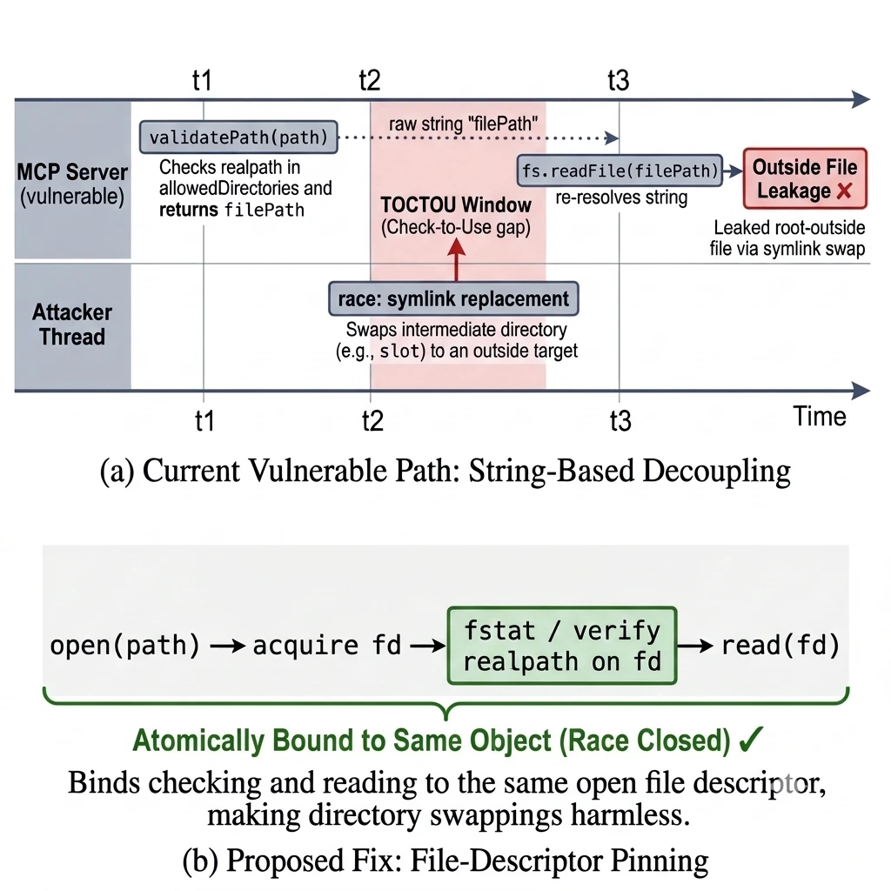

# server-filesystem read-path TOCTOU (GHSA-9p4m-hpfp-xh36)

`@modelcontextprotocol/server-filesystem@2.2.0`에서 경로 검증과 실제 읽기 사이의 경쟁(TOCTOU)으로, `--read-only`에서도 허용 디렉터리 밖 파일이 읽히는 결함 분석.


| | |
|---|---|
| Package | `@modelcontextprotocol/server-filesystem` (npm) |
| Affected | 2.2.0에서 확인 (공개 권고 기준 < 2.3.0) |
| Advisory | GHSA-9p4m-hpfp-xh36 (본 제보, 제보 시 잠정 Low) · 같은 유형 공개 권고 [GHSA-p9cv-8g75-4xcg](https://github.com/modelcontextprotocol/servers/security/advisories/GHSA-p9cv-8g75-4xcg) (Medium 4.4, CWE-367) |
| Status | 본 제보는 먼저 접수된 제보와 중복으로 Closed. 벤더 권고상 2.3.0(2026-11-11)에서 수정(2.3.0은 직접 시험하지 않음) |

## 한눈에

이 MCP 파일서버는 "허용된 폴더 밖은 못 읽는다"를 보장한다고 여겨진다 — `--read-only`면 더더욱. 하지만 서버가 경로를 **검사한 순간과 실제로 읽는 순간 사이에** 공격자가 중간 폴더를 '바깥으로 가는 지름길(심링크)'로 바꿔치기하면, 같은 경로가 허용 범위 밖 파일을 읽는다(경쟁 조건, TOCTOU). 미리 걸어둔 링크는 막히지만 이 '찰나의 교체'는 통과한다. 미수정 공개 버전에서 재현했고, 검사와 읽기를 같은 파일 핸들에 고정하는 수정안을 제시한다.

## 요약

허용 루트 하위의 쓰기 가능한 중간 디렉터리를, 검증(`validatePath()`)과 읽기(`fs.readFile()`) 사이에 외부를 가리키는 심링크로 교체하면, 같은 `allowedDirectories` 경로가 루트 밖 파일의 내용을 반환한다. 정적 심링크는 거부되지만 경쟁 교체는 통과한다. 미수정 published npm 아티팩트(바이트 동일성 검증)에 대해 재현했다.

## 근본 원인

`validatePath()`가 반환한 경로 **문자열**을 나중에 `fs.readFile()`이 다시 해석하기 때문에, 그 사이 부모 디렉터리가 교체되면 같은 문자열이 다른 파일을 연다.

- `src/filesystem/lib.ts` `validatePath()` (~517–540) — realpath 검사 후 경로 문자열 반환
- `src/filesystem/server.ts` `readTextFileHandler` (~325–350) — 위 검사를 await하고 `readFileContent(validPath)` 호출
- `src/filesystem/lib.ts` `readFileContent` (~578–583) — 별도로 `fs.readFile(filePath)` 호출



*정적 심링크는 validatePath 에서 거부되지만, 검증과 읽기 사이의 교체(TOCTOU)는 통과한다. `--read-only` 에서도 발생.*

## 선행 어드바이저리와의 차이

- `GHSA-q66q-fx2p-7w4m` — 정적 심링크 (본 건은 경쟁)
- `GHSA-7rgq-gccq-qphx` — 경로 정규화 불일치
- `GHSA-53mr-w429-c597` — 쓰기 경로 TOCTOU, 2.0.1에서 수정. 본 건은 **읽기 경로**이고 2.2.0에서 확인(2.3.0에서 수정)

## 검증

미수정 npm tarball(SHA-256 `a31b8e4e…0889`, registry SHA-512 일치)에 대해, 사전등록 레이스에서 1,270회째에 적중(응답 `id=1272`)해 외부 파일 내용과 정확히 일치하는 응답을 받았다. 외부 난수 값은 어떤 요청에도 등장하지 않았다. 첫 적중까지의 호출 수는 요청당 성공률 추정치가 아니다. 후보 패치로 7개 content 반환 모드 × 각 1,000회 레이스에서 외부 내용 반환 0건, 파일시스템 테스트 667 pass / 6 skip.

검증 범위: 동일 UID 두 프로세스(서로 다른 Seatbelt 정책). 미검증: 다른 UID, 원격, Linux/Windows, 실제 비밀, 네트워크 반출, 벤더 수정판 2.3.0.

## 재현 (결함 확인)

```
node dist/index.js --read-only /path/lab/allowed
# allowed/slot/note.txt(내부), outside/note.txt(외부) 생성
# read_text_file(allowed/slot/note.txt) → 내부 값
# slot 을 outside 로의 정적 심링크로 교체 → 거부(정상)
# 검증~읽기 사이에 slot 을 심링크로 교체하는 레이스 → 외부 내용 반환
```

2.3.0 미만을 쓰는 환경이 남아 있을 수 있어 **작동 레이스 러너와 증거 번들은 공개하지 않는다.** 위는 개념 절차다.

## 후보 수정

경로 문자열을 재해석하지 말고 검증과 읽기를 같은 파일 핸들에 고정한다: 먼저 열어(fd 확보) 그 fd의 realpath가 허용 루트에 포함되는지 검증하거나, `O_NOFOLLOW` + 디렉터리 fd 기준 `openat`.

## 디스클로저

`GHSA-9p4m-hpfp-xh36`로 비공개 제보했고, 벤더가 먼저 접수된 비공개 제보와 중복으로 Closed했다. 같은 유형 결함의 공개 권고 `GHSA-p9cv-8g75-4xcg`(Medium 4.4)가 2026-11-11에 나왔고 2.3.0에서 수정됐다. 2.3.0 미만 환경이 남아 있을 수 있어 턴키 러너는 비공개.

## License

MIT (`LICENSE`).
